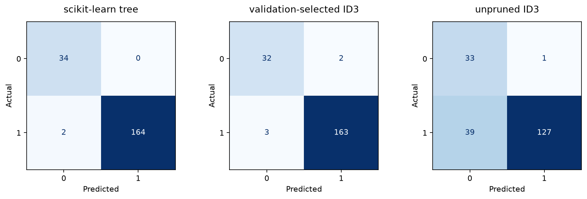
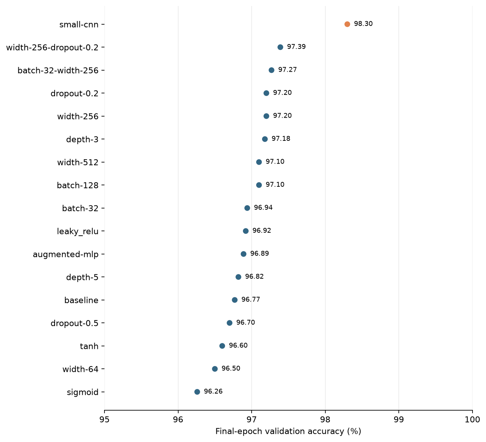
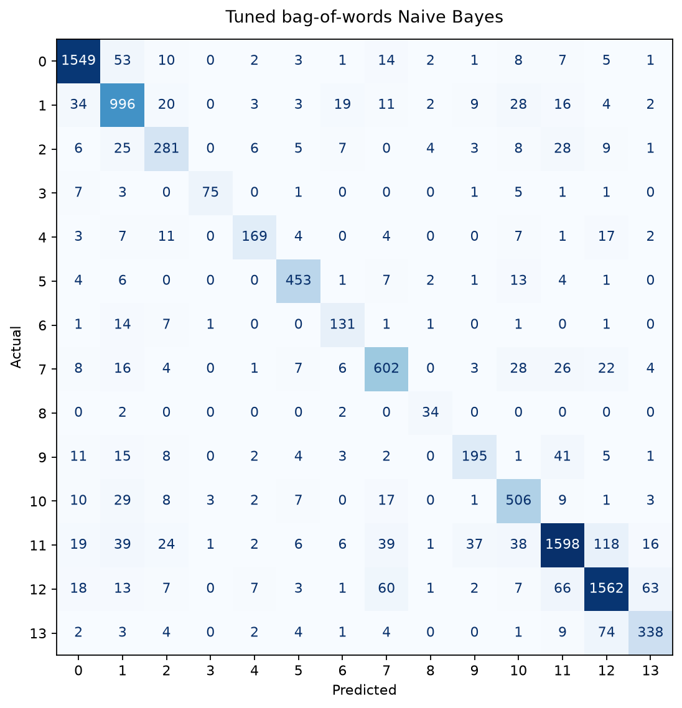

# 结果与分析

以下结果由本项目使用基准数据复跑，随机种子均为 42。环境为 Windows、Python 3.14.7、scikit-learn 1.9.1 和 PyTorch 2.15.0 CPU。

## 银行贷款审批

验证阶段使用 640 条训练样本和 160 条验证样本。两棵树选定参数后使用全部 800 条训练数据重训，测试集有 200 条。库版树选出信息熵、最大深度 4、最小分裂样本数 6 及最小叶样本数 1。ID3 选出最大深度 3。

| 测试模型 | Accuracy | Precision | Recall | F1 |
| --- | ---: | ---: | ---: | ---: |
| scikit-learn 决策树 | 0.9900 | 1.0000 | 0.9880 | 0.9939 |
| ID3，深度 3 | 0.9750 | 0.9879 | 0.9819 | 0.9849 |
| ID3，不限深度 | 0.8000 | 0.9922 | 0.7651 | 0.8639 |

深度 3 的 ID3 将漏判的批准样本从 39 条降到 3 条，说明在这组数据上限制树深有明显收益。测试集批准样本占 83%，验证集占 65%。解读准确率时应结合正类召回率和这组样本的类别比例。

## 手写数字识别

在 MNIST 上用相同的 50,000 / 10,000 / 10,000 划分比较了 17 组配置，每组训练 5 轮。下表列出基线及新增配置的最后一轮验证结果。

| 配置 | 验证准确率 | 验证交叉熵 |
| --- | ---: | ---: |
| 基线 MLP，宽度 128、批量 64 | 96.77% | 0.1113 |
| 联合调参，批量 32 + 宽度 256 | 97.27% | 0.0958 |
| 联合调参，宽度 256 + Dropout 0.2 | 97.39% | 0.0884 |
| 基线 MLP + 训练集旋转与平移 | 96.89% | 0.0993 |
| 小型 CNN | 98.30% | 0.0596 |

单独增宽时，宽度 512 的训练准确率（98.93%）高于宽度 256（98.72%），验证准确率则分别为 97.10% 和 97.20%。在相同训练轮数下，联合使用宽度 256 与 Dropout 0.2 取得了本轮 MLP 对照的最高验证准确率。只对训练集做增强，基线 MLP 的验证准确率上升了 0.12 个百分点。

小型 CNN 按验证准确率入选。它有 20,586 个可训练参数，测试准确率为 **98.46%**，Macro-F1 为 **0.9844**，测试交叉熵为 0.0476。

## 中文新闻标题分类

训练、验证、测试集分别有 80,000、10,000、10,000 条标题，覆盖 14 类。训练集中科技类有 15,549 条，星座类有 300 条。标题长度的中位数为 20 个字符，中间一半在 17 至 23 个字符之间。

验证集上，unigram 与 `alpha=0.05` 的组合取得最高 Macro-F1（0.8128）。固定 unigram 与 `alpha=1` 后，手写和库版模型在验证集、测试集各 10,000 条样本上的逐条预测完全一致。

| 测试模型 | Accuracy | Macro-F1 | Weighted-F1 |
| --- | ---: | ---: | ---: |
| BOW + MultinomialNB | 0.8489 | 0.8208 | 0.8488 |
| TF-IDF + MultinomialNB | 0.8478 | 0.8184 | 0.8456 |
| unigram BOW + LinearSVC | 0.8565 | 0.8271 | 0.8561 |

在这组标题上，把词频换成 TF-IDF 后，Macro-F1 略有下降。LinearSVC 的 Macro-F1 高于两组朴素贝叶斯。词袋朴素贝叶斯将 118 条科技标题判成股票、74 条财经标题判成股票。企业发布、业绩等词汇可能横跨这些类别，只有少量关键词的标题更容易混淆。

图中编号 0 至 13 依次为体育、娱乐、家居、彩票、房产、教育、时尚、时政、星座、游戏、社会、科技、股票、财经。
